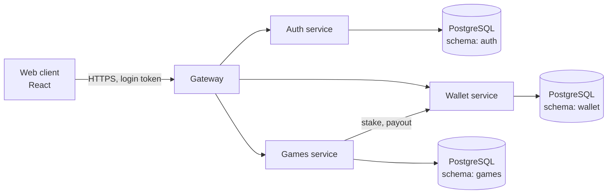

# Architecture

## Overview

The browser talks only to the gateway. The gateway checks the login token, then forwards the request to the service that owns it, adding the player's id and a key shared between the services. A service rejects any request without that key, so it cannot be called from outside even if it were reachable.

## Services

| Service | Port | Owns | Public routes (through the gateway) |
| --- | --- | --- | --- |
| gateway | 8080 | Nothing; routing and token checks | `/api/*` |
| auth | 8081 | Accounts, passwords, tokens | `/api/auth/register`, `/api/auth/login`, `/api/auth/me` |
| wallet | 8082 | Balances, ledger | `/api/wallet/me/balance`, `/me/transactions`, `/me/faucet` (dev) |
| games | 8083 | Seeds, bets, matches, rounds | `/api/games/roulette/spin`, `/versus`, `/jackpot`, `/fair/*` |

The wallet's `/internal/transactions` endpoint moves money. It is called only by other services and is not routed by the gateway.

## Rules the code keeps

1. **Money is whole numbers.** Amounts are `bigint` counts of the currency's smallest unit, sent as decimal strings. No floating point touches a balance.
2. **The wallet is the only place balances change.** Games ask it to take a stake or pay a prize. A balance can never go below zero.
3. **Every money movement has an id chosen by the caller.** Sending it twice applies it once, so a retry after a timeout is safe.
4. **Stake first, outcome second.** A game takes the stake before it computes the result.
5. **Commit before the bet, reveal after.** The hash of the server seed is published before any bet and the seed itself only afterwards. See [provably-fair.md](provably-fair.md).
6. **Game rules are pure functions.** `packages/games` has no I/O, so the rules are tested exhaustively and the browser can reuse them.
7. **Secrets come from the environment.** In production the services refuse to start with the placeholder values.

## Data

`db/migrations/001_init.sql` defines one schema per service: `auth`, `wallet` and `games`. A service reads and writes only its own schema, and `002_service_roles.sql` enforces this with a group role per service (`yuubet_auth`, `yuubet_wallet`, `yuubet_games`). The wallet role may insert ledger entries but never update or delete them. Each environment creates one login role per service as a member of its group role.

Migrations are applied by `npm run db:migrate` (`packages/db`): each file runs in its own transaction, is recorded in `public.schema_migrations` with a checksum, and is never edited after it has been applied. `packages/db` also provides the connection pool and a `transaction` helper that rolls back on error and runs the transaction again after a serialization failure or deadlock. Constraints enforce the important rules in the database too: non-negative balances, one active seed pair per player, one open jackpot round.

**The services do not use the database yet.** State is in memory behind small classes (`UserStore`, `Ledger`, `GamesService`) whose shape follows the tables. Moving them to PostgreSQL is the first milestone.

## Current limits

- State is lost on restart, and a service cannot run as more than one instance.
- No real deposits or withdrawals; only a development faucet.
- If the wallet call that pays a prize fails in Roulette or Versus, the payout is not retried. Jackpot retries.
- Clients poll for updates; there is no push channel yet.
- The HTTP layer is a small router on `node:http`, with no rate limiting.
- No admin tools, KYC, limits or responsible-gambling controls.

## Adding a game

1. Put the rules in `packages/games` as pure functions with tests, including a test of the house edge.
2. Add the flow to `services/games`: validate, take the stake, compute the result with `fairInt`, pay out.
3. Return the published hash with every bet and the server seed once it can no longer matter.
4. Add a table to a new migration, and a page in `web/src/pages`.
5. Add the game to the verifier on the Fairness page.
